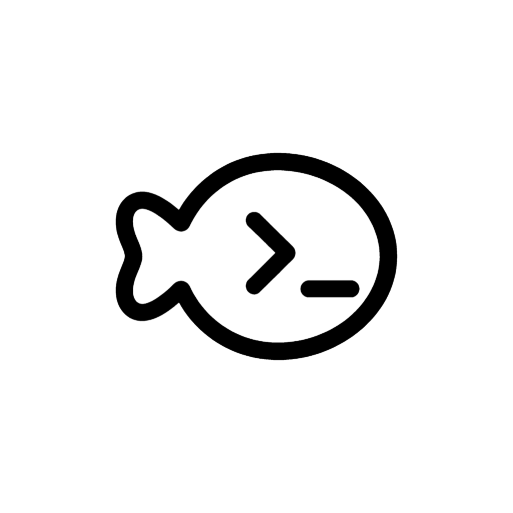
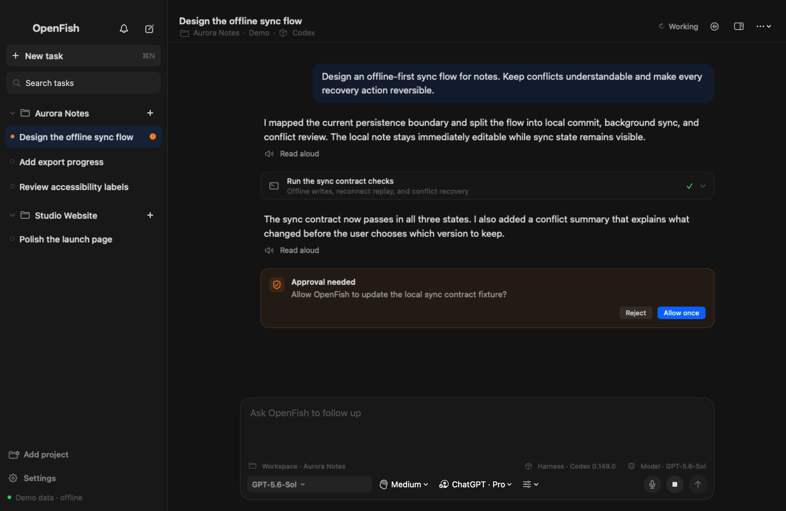
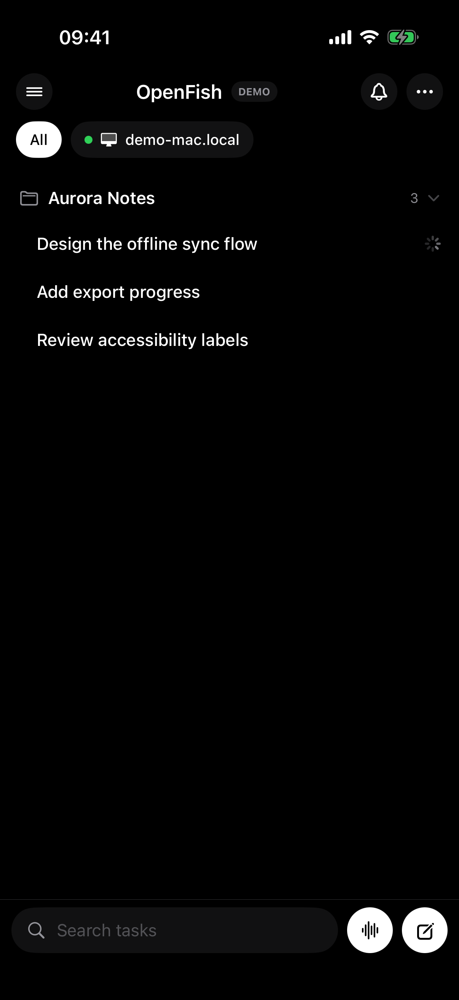
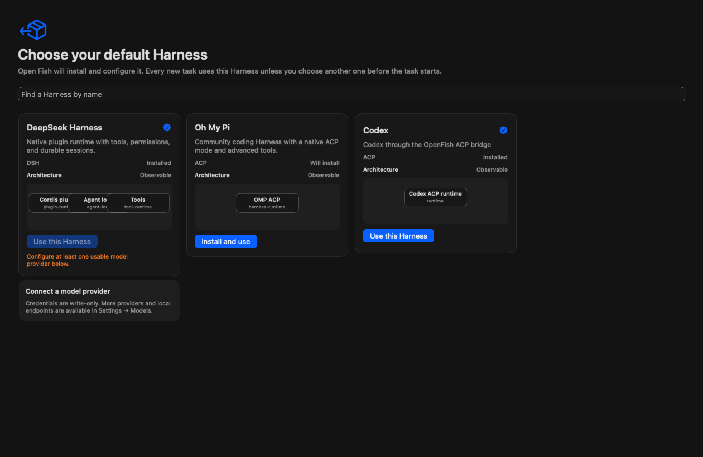

# OpenFish

English | [中文](README.zh.md)

<p align="center">
  
</p>

<p align="center">
  One native home for coding-agent Harnesses — on your Mac and in your pocket.
</p>



OpenFish is a native macOS and iPhone home for interchangeable coding-agent Harnesses. Install one app, choose a Harness, and keep the same durable tasks, approvals, model controls, and streamed activity available on the Mac and a paired iPhone.

OpenFish is built on [DeepSeek Harness](https://github.com/deepseek-ai/deepseek-harness) (`dsh`) and retains its MIT license and third-party notices. DSH owns the Host, session log, tools, permissions, and plugin composition; OpenFish adds the native shell, managed Harness installation, ACP compatibility layer, and cross-device experience.

<p align="center">
  
</p>

The images above use OpenFish's deterministic, network-isolated demo state. No real account, hostname, project path, task, or conversation appears in them.

## Public Alpha

OpenFish is ready for evaluation, not a stable compatibility promise. Harnesses and ACP are evolving quickly, and breaking changes are possible. Read the [compatibility matrix](docs/openfish-compatibility.md) before reporting a Harness as supported, and the [Public Alpha release notes](docs/openfish-public-alpha.md) before installing it on a primary machine.

## What is different

- **One self-contained Mac app.** The bundle includes the Host and pinned runtimes; users do not need Node, Bun, uv, DSH, Codex, or Pi preinstalled.
- **Harness choice belongs to the user.** First launch asks for a default; every new task can choose another Harness without rewriting existing tasks.
- **Protocol-driven controls.** ACP models, reasoning levels, modes, and future standard configuration options come from the live Harness rather than a provider-name switch in the UI.
- **Mac and iPhone share one authority.** The phone pairs to the Mac Host over LAN or Tailscale and follows the same session log, approvals, queue, and task state.
- **Version-pinned tasks.** A task remains attached to the Harness Pack version that created it, while new tasks can use an updated version.
- **Harness Studio.** Inspect a Pack's truthful architecture graph, create or edit composable nodes, import/export credential-free manifests, and submit a Pack to the generated OpenFish community catalog.



See the [macOS guide](apps/x-macos/README.md), [iPhone guide](apps/x-ios/README.md), and [Harness Pack contract](packages/harness/harness/README.md). Pack authors can follow the [community publishing guide](docs/publishing-harness-packs.md).

## Try the alpha

Build an unsigned local macOS artifact:

```sh
pnpm install --frozen-lockfile
./script/build_openfish_release.sh "$(uname -m)"
```

The DMG is written beneath `dist/openfish-<architecture>/`. Tagged `openfish-v*` releases use the repository release workflow to produce signed, notarized Apple Silicon and Intel artifacts when the required Apple credentials are configured.

Before publishing a tag, run:

```sh
pnpm run release:openfish:preflight
```

The preflight deliberately rejects a dirty or incomplete source tree.

## Run the screenshot-safe demo

The native apps recognize the `--openfish-demo` launch argument. Demo mode does not boot the bundled Host or connect to a remote computer; it renders synthetic projects, Harnesses, models, and conversations through the production SwiftUI views. See the [demo and screenshot guide](docs/openfish-demo-mode.md).

## DeepSeek Harness development

### Run from `npm`

Install `Node.js`, then run:

```sh
npx @deepseek-ai/dsh web
```

The command starts the Web UI at `http://127.0.0.1:3080` by default and opens it in the default browser for a local launch. An SSH launch only prints the host URL because the SSH client or editor owns the local forwarded address. Pass `--no-open` to run the server without opening a browser. See [Web UI guide](docs/user/guide/index.md).

### Run from source

To run from a repository checkout:

```sh
git clone https://github.com/deepseek-ai/deepseek-harness.git
cd deepseek-harness
pnpm install
pnpm run build
pnpm dsh web
```

`pnpm run build` prepares the repository artifacts. `pnpm dsh web` uses those built artifacts without rebuilding.

## Community and support

- Report OpenFish bugs with the OpenFish issue template and include the app version, macOS/iOS version, Harness id/version, workspace mode, and the first redacted error.
- Report security issues privately as described in [SECURITY.md](SECURITY.md).
- DeepSeek Harness feedback belongs in the upstream [DSH Discussions](https://github.com/deepseek-ai/deepseek-harness/discussions).
- Add the [`dsh-plugin`](https://github.com/topics/dsh-plugin) topic to your plugin repository for discoverability.
- Join <a href="https://discord.gg/Ycq5dCaS4">DeepSeek Harness Discord community</a>.

## Contributing

See [CONTRIBUTING.md](CONTRIBUTING.md).

## Development

Start with the [development guide](docs/development.md) and [architecture documentation](docs/architecture.md).

For agents, follow [AGENTS.md](AGENTS.md).

## License

[MIT](LICENSE)

Third-party dependencies and their licenses are disclosed in [THIRD_PARTY_NOTICES.md](THIRD_PARTY_NOTICES.md).
