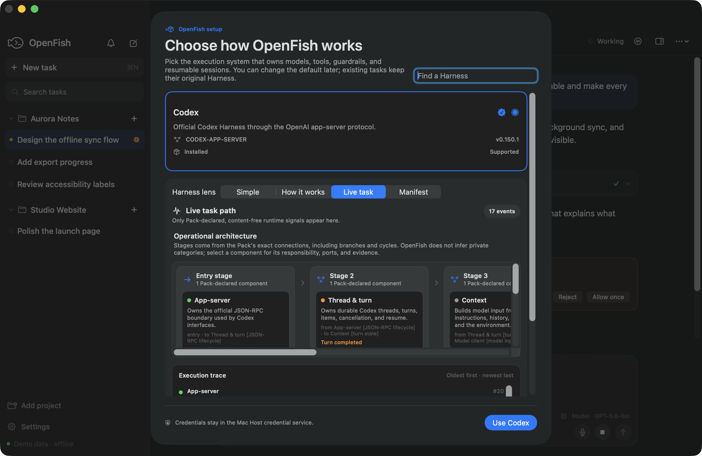
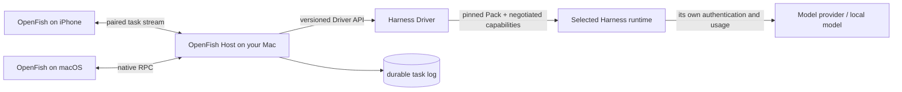

# OpenFish

English | [中文](README.zh.md)

<p align="center">
  
</p>

<p align="center">
  One native home for coding-agent Harnesses — on your Mac and in your pocket.
</p>

Its DSH foundation uses an **everything-is-a-plugin** architecture powered by [Cordis](https://github.com/cordiverse/cordis), whose design is described in [_A Programming Paradigm for Spatiotemporal Composability_](https://arxiv.org/abs/2608.25512).

Upstream DSH documentation: [https://deepseek-harness.github.io/deepseek-harness/](https://deepseek-harness.github.io/deepseek-harness/)


OpenFish is a native macOS and iPhone home for interchangeable coding-agent Harnesses. Install one app, choose a Harness, and keep the same durable tasks, approvals, model controls, and streamed activity available on the Mac and a paired iPhone.

OpenFish and DeepSeek Harness are in _developer preview_ and iterating rapidly. **THERE WILL BE COMPATIBILITY-BREAKING CHANGES.**

Review the [safety notice](SAFETY.md) before running the project.

OpenFish is built on [DeepSeek Harness](https://github.com/deepseek-ai/deepseek-harness) (`dsh`) and retains its MIT license and third-party notices. DSH provides the Host-side control plane, durable event log, credential boundary, process supervision, and device transport. The selected Harness still owns its agent loop, model-facing context, tool semantics, approvals, and remote-session behavior; its versioned Driver maps only the capabilities it actually exposes. OpenFish adds the native shell, managed Harness installation, protocol adapters, and cross-device experience.

<p align="center">
  
</p>

The images above use OpenFish's deterministic, network-isolated demo state. No real account, hostname, project path, task, or conversation appears in them.

## Public Alpha

This source tree is a Public Alpha release candidate, not a stable compatibility promise or a passed release certificate. Harnesses and ACP are evolving quickly, and breaking changes are possible. Read the [compatibility matrix](docs/openfish-compatibility.md) before reporting a Harness as supported, the [value-evidence status](docs/openfish-value-evidence.md) for what has and has not been demonstrated, the [threat model](docs/openfish-threat-model.md), and the [Public Alpha release notes](docs/openfish-public-alpha.md) before installing it on a primary machine.

## Why OpenFish exists

OpenAI now publishes the Codex Harness and documents `exec`, the SDK, and app-server as product integration layers. The ACP Registry already distributes dozens of agents, including Codex, Claude, Cursor, Gemini, OpenCode, Pi, and Copilot. Those projects make the underlying agent loops easier to embed; they do not give a user one neutral, self-contained native place to install, isolate, compare, configure, resume, and carry different Harnesses onto a phone.

OpenFish is therefore not a renamed Codex client and does not claim that every CLI is automatically compatible. It is the local control plane around a selected Harness. ACP-compatible Harnesses share the generic Driver; a genuinely new protocol supplies a versioned Driver plugin. The shell keeps Host, Harness, account, provider, model, workspace, permissions, and version visibly separate instead of flattening them into one model picker.

See OpenAI's [open Harness platform description](https://learn.chatgpt.com/blog/codex-as-a-platform) and the live [ACP Registry](https://agentclientprotocol.com/registry) for the ecosystem baseline used by this positioning.

## What is different

- **One self-contained Mac app.** The bundle includes the Host and pinned runtimes; users do not need Node, Bun, uv, DSH, Codex, or OMP preinstalled.
- **Harness choice belongs to the user.** First launch asks for a default; every new task can choose another Harness without rewriting existing tasks.
- **Protocol-driven controls.** Models, reasoning levels, modes, and future standard configuration options come from the live Harness or its admitted Driver contract rather than a provider-name switch in the UI.
- **Managed isolation, not a launcher menu.** Exact versions, authentication profiles, runtime state, updates, rollback, cancellation, and uninstall are owned per Harness; Registry discovery is never presented as a security endorsement.
- **Mac and iPhone share one authority.** The phone pairs to the Mac Host over LAN or Tailscale and follows the same session log, approvals, queue, and task state.
- **Version-pinned tasks.** A task remains attached to the Harness Pack version that created it, while new tasks can use an updated version.
- **Progressive Harness Lens.** Start with a plain-language summary, inspect an evidence-backed architecture, then follow a bounded, ordered, content-free execution trace through only the nodes and connections that the Pack declares observable. Selecting a component filters the trace to the steps that actually touched it. Manifest Editor on the Mac can create or edit declared composable nodes, run a prompt-free live preflight, and exchange credential-free manifests. A preflight may still create provider-owned session state or incur provider-specific setup cost; unknown private internals stay visibly opaque instead of becoming invented diagrams.




The Harness Lens image is rendered by the production SwiftUI view in network-isolated Demo State. Its Codex architecture follows the admitted Pack, while the 17 runtime observations are deterministic synthetic signals; no prompt, output, command, path, account, or credential appears in the trace.

## What actually runs



The Mac Host is the authority for task state and credentials. OpenFish does not turn one provider subscription into another: Codex, DSH, OMP, and future Harnesses keep their own authentication, model directory, reasoning options, runtime behavior, and charges. The versioned Driver boundary translates only capabilities the Harness declares; anything else stays explicitly unsupported or opaque.

See the [macOS guide](apps/x-macos/README.md), [iPhone guide](apps/x-ios/README.md), and [Harness Pack contract](packages/harness/harness/README.md). Pack authors can follow the [community publishing guide](docs/publishing-harness-packs.md).

## Try the alpha

Build an unsigned local macOS artifact:

```sh
git clone https://github.com/Yusong-Enceladus/OpenFish.git
cd OpenFish
pnpm install --frozen-lockfile
./script/build_openfish_release.sh "$(uname -m)"
```

The DMG is written beneath `dist/openfish-<architecture>/`. Tagged `openfish-v*` releases use the repository release workflow to produce signed, notarized Apple Silicon and Intel artifacts when the required Apple credentials are configured.

Before publishing a tag, run:

```sh
pnpm run release:openfish:preflight
```

The preflight deliberately rejects a dirty or incomplete source tree.

## Run the screenshot-safe demo

The native apps recognize the `--openfish-demo` launch argument. Demo mode does not boot the bundled Host or connect to a remote computer; it renders synthetic projects, Harnesses, models, and conversations through the production SwiftUI views. See the [demo and screenshot guide](docs/openfish-demo-mode.md).

## DeepSeek Harness development

### Run from `npm`

Install `Node.js`, then run:

```sh
npx @deepseek-ai/dsh web
```

The command starts the Web UI at `http://127.0.0.1:3080` by default and opens it in the default browser for a local launch. An SSH launch only prints the host URL because the SSH client or editor owns the local forwarded address. Pass `--no-open` to run the server without opening a browser. See [Web UI guide](docs/user/guide/index.md).

### Run from source

To run from a repository checkout:

```sh
git clone https://github.com/deepseek-ai/deepseek-harness.git
cd deepseek-harness
pnpm install
pnpm run build
pnpm dsh web
```

`pnpm run build` prepares the repository artifacts. `pnpm dsh web` uses those built artifacts without rebuilding.

## Community and support

- Report OpenFish bugs with the OpenFish issue template and include the app version, macOS/iOS version, Harness id/version, workspace mode, and the first redacted error.
- Report security issues privately as described in [SECURITY.md](SECURITY.md).
- DeepSeek Harness feedback belongs in the upstream [DSH Discussions](https://github.com/deepseek-ai/deepseek-harness/discussions).
- Add the [`dsh-plugin`](https://github.com/topics/dsh-plugin) topic to your plugin repository for discoverability.
- Join <a href="https://discord.gg/Ycq5dCaS4">DeepSeek Harness Discord community</a>.

## Contributing

See [CONTRIBUTING.md](CONTRIBUTING.md).

## Development

Start with the [development guide](docs/development.md) and [architecture documentation](docs/architecture.md).

For agents, follow [AGENTS.md](AGENTS.md).

## License

[MIT](LICENSE)

Third-party dependencies and their licenses are disclosed in [THIRD_PARTY_NOTICES.md](THIRD_PARTY_NOTICES.md).
