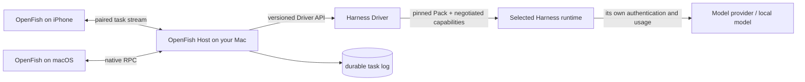

# OpenFish

[English](README.md) | 中文

<p align="center">
  
</p>

<p align="center">一个承载多种编程智能体 Harness 的原生入口：Mac 上用，手机上继续。</p>

其 DSH 基座采用**一切皆插件**的架构，由 [Cordis](https://github.com/cordiverse/cordis) 驱动；设计参见论文 [_A Programming Paradigm for Spatiotemporal Composability_](https://arxiv.org/abs/2608.25512)。

上游 DSH 文档：[https://deepseek-harness.github.io/deepseek-harness/](https://deepseek-harness.github.io/deepseek-harness/)


OpenFish 是一个原生 macOS 与 iPhone 编程智能体客户端：用户只安装一个应用，选择自己要用的 Harness，并在 Mac 与已配对的 iPhone 上继续使用同一批持久任务、审批、模型控制和实时活动。

OpenFish 与 DeepSeek Harness 均处于 _开发者预览_ 阶段，正在快速迭代。**未来将出现破坏兼容性的变更。**

运行本项目前，请阅读[安全说明](SAFETY.zh.md)。

<a id="run"></a>

OpenFish 构建在 [DeepSeek Harness](https://github.com/deepseek-ai/deepseek-harness) （`dsh`）之上，并保留其 MIT 许可证与第三方声明。DSH 提供 Host 侧控制平面、持久事件日志、凭证边界、进程监管和设备传输；所选 Harness 仍拥有自己的 Agent Loop、面向模型的上下文、工具语义、审批和远端会话行为，版本化 Driver 只映射它真实暴露的能力。OpenFish 增加原生壳子、托管式 Harness 安装、协议适配与跨设备体验。

<p align="center">
  
</p>

以上图片来自 OpenFish 确定性、网络隔离的 Demo 状态，不含真实账号、主机名、项目路径、任务或对话。

## Public Alpha

当前源码树是 Public Alpha Release Candidate，不是稳定兼容承诺，也不等于已经取得发布证书。Harness 与 ACP 都在快速变化，未来可能出现破坏性变更。判断某个 Harness 是否受支持前，请先阅读[兼容矩阵](docs/openfish-compatibility.zh.md)，通过[价值证据状态](docs/openfish-value-evidence.zh.md)了解哪些结论尚未得到证明，并在主力电脑安装前阅读[威胁模型](docs/openfish-threat-model.zh.md)与 [Public Alpha 发布说明](docs/openfish-public-alpha.zh.md)。

## 为什么需要 OpenFish

OpenAI 目前已经公开 Codex Harness，并把 `exec`、SDK 与 app-server 作为正式的产品集成层。ACP Registry 也已经分发数十个 agent，其中包括 Codex、Claude、Cursor、Gemini、OpenCode、Pi 与 Copilot。这些项目降低了嵌入 agent loop 的难度，但不会为用户提供一个提供方无关、自包含的原生入口，用来安装、隔离、比较、配置及恢复不同 Harness，并把任务延续到手机。

因此，OpenFish 不是改名后的 Codex 客户端，也不会声称所有 CLI 都能自动兼容。它是围绕所选 Harness 工作的本地控制面。兼容 ACP 的 Harness 共用通用 Driver；采用全新协议的 Harness 则提供版本化 Driver 插件。壳子会明确区分 Host、Harness、账号、提供方、模型、工作区、权限与版本，而不是把这些概念压扁成一个模型选择器。

该定位以 OpenAI 的[开放 Harness 平台说明](https://learn.chatgpt.com/blog/codex-as-a-platform)与实时 [ACP Registry](https://agentclientprotocol.com/registry)为当前生态基线。

## 它有什么不同

- **一个自包含 Mac 应用。** 应用内含 Host 与固定版本的 Runtime，用户无需预装 Node、Bun、uv、DSH、Codex 或 OMP。
- **Harness 选择权属于用户。** 首次启动选择默认项；每个新任务仍可换用其他 Harness，旧任务不会被改写。
- **控件由协议驱动。** 模型、思考强度、模式与未来标准选项来自正在运行的 Harness 或已经准入的 Driver 约定，而不是 UI 中按厂商名称写死。
- **托管隔离，而非启动器菜单。** OpenFish 按 Harness 管理精确版本、认证配置、运行时状态、更新、回滚、取消与卸载；Registry 可发现性绝不会显示成安全背书。
- **Mac 与 iPhone 共享一个权威状态。** 手机通过 LAN 或 Tailscale 配对到 Mac Host，共用会话日志、审批、队列与任务状态。
- **任务固定 Harness 版本。** 已有任务继续使用创建时的 Pack；新任务可以选更新版本。
- **先证明，再信任。** 每个准确 Pack 版本都有可见的证据账本，明确区分已经准入的声明、解析出的可执行身份、真实 Session 观测、Host 的兼容性评估，以及刻意保持不透明的边界。一个版本的证据绝不会套到另一个版本上；Registry 收录也绝不会变成兼容性或质量徽章。
- **渐进式 Harness Lens。** **Overview** 用普通语言解释当前路线，**Map** 只展示 Harness 边界内有证据的职责和关系，**Trace** 展示有界、有序、无内容的实际执行路径，**Studio** 只开放 Driver 真正支持的可编辑控件。Studio 包含撤销／重做、重大变更 Review、不会写入状态的准入 Dry Run、准确版本安装／预检，以及不含凭证的导入导出；无法验证的私有内部结构会明确保持不透明，不会被画成臆造架构。
- **Harness Lab，不做伪排行榜。** Mac 可让两个或更多已安装 Harness 在相互隔离的 No Project Session 中运行同一项用户任务，并为每条路线明确选择模型、思考强度、权限模式、轮换顺序、重复次数和超时。OpenFish 绝不会代替用户回答 Approval Request；所选权限模式仍可能允许某项操作无需询问。机械失败、耗时与 Usage 和用户自己的 1–5 质量判断分开记录；可选导出经过脱敏，默认不含 Response、账号数据和任务原文。这些运行会使用所选 Provider，并可能消耗其额度。


Harness Lens 图片由生产 SwiftUI 界面在网络隔离的 Demo State 中渲染。Codex 架构来自已经准入的 Pack，17 条 Runtime Observation 则是确定性的合成信号；轨迹中不含 Prompt、Output、Command、Path、Account 或 Credential。

## 实际运行关系



Mac Host 是任务状态和凭据的权威来源。OpenFish 不会把一种 Provider 订阅变成另一种：Codex、DSH、OMP 以及未来 Harness 都保留自己的认证、模型目录、思考选项、Runtime 行为和费用。版本化 Driver 边界只转换 Harness 明确声明的能力；其余能力会明确显示为不支持或保持 Opaque。

详见 [macOS 指南](apps/x-macos/README.zh.md)、[iPhone 指南](apps/x-ios/README.zh.md)与 [Harness Pack 契约](packages/harness/harness/README.zh.md)。Pack 作者可以阅读 [社区发布指南](docs/publishing-harness-packs.zh.md)。

## 试用 Alpha

从源码构建本地未签名 macOS 产物：

```sh
git clone https://github.com/Yusong-Enceladus/OpenFish.git
cd OpenFish
pnpm install --frozen-lockfile
./script/build_openfish_release.sh "$(uname -m)"
```

DMG 会输出到 `dist/openfish-<architecture>/`。配置 Apple 发布凭证后，`openfish-v*` 标签会通过仓库 Release 工作流生成签名并公证的 Apple Silicon 与 Intel 产物。

发布标签之前运行：

```sh
pnpm run release:openfish:preflight
```

该检查会主动拒绝脏工作区或缺失发布文件的源码树。

## 运行截图安全的 Demo

Mac 与 iPhone 原生应用都支持 `--openfish-demo` 启动参数。Demo 模式不会启动内置 Host，也不会连接远程电脑；它只用生产 SwiftUI 界面渲染合成的项目、Harness、模型与对话。详见 [Demo 与截图指南](docs/openfish-demo-mode.zh.md)。

<a id="deepseek-harness-development"></a>

## DeepSeek Harness 开发

### 通过 `npm` 运行

安装 `Node.js`，然后运行：

```sh
npx @deepseek-ai/dsh web
```

该命令默认会在 `http://127.0.0.1:3080` 启动 Web UI，本机启动时还会用默认浏览器打开页面。通过 SSH 启动时只打印宿主机 URL，因为本地转发地址由 SSH 客户端或编辑器持有。传入 `--no-open` 可仅运行服务器而不打开浏览器。详见 [Web UI 指南](docs/user/guide/index.zh.md)。

<a id="run-from-source"></a>

### 从源码运行

如需从仓库源码运行：

```sh
git clone https://github.com/deepseek-ai/deepseek-harness.git
cd deepseek-harness
pnpm install
pnpm run build
pnpm dsh web
```

`pnpm run build` 会准备仓库产物。`pnpm dsh web` 会直接使用这些已构建产物，不会重新构建。

## 社区与支持

- OpenFish Bug 请使用 OpenFish Issue 模板，并提供应用版本、macOS／iOS 版本、Harness id／版本、工作区模式与首条脱敏错误。
- 安全问题请按 [SECURITY.md](SECURITY.md) 私下报告。
- DeepSeek Harness 本身的问题请提交到上游 [DSH Discussions](https://github.com/deepseek-ai/deepseek-harness/discussions)。
- 为你的插件仓库添加 [`dsh-plugin`](https://github.com/topics/dsh-plugin) 话题，便于被发现。
- 欢迎加入 DeepSeek Harness 企微群：扫码添加企微小助手并填写入群问卷，完成后小助手会邀请你入群。

<table>
  <thead>
    <tr>
      <th align="center">企微小助手</th>
      <th align="center">入群问卷</th>
      <th align="center">微信公众号</th>
    </tr>
  </thead>
  <tbody>
    <tr>
      <td align="center"></td>
      <td align="center"><a href="https://trtgsjkv6r.feishu.cn/share/base/form/shrcnIt5twSVdLGD52KJBckGCgg"></a></td>
      <td align="center"></td>
    </tr>
  </tbody>
</table>

## 参与贡献

参见 [CONTRIBUTING.md](CONTRIBUTING.zh.md)。

## 开发

请先阅读[开发指南](docs/development.zh.md)与[架构文档](docs/architecture.zh.md)。

面向 agent：请遵循 [AGENTS.md](AGENTS.md)。

## 许可证

[MIT](LICENSE)

第三方依赖及其许可证见 [THIRD_PARTY_NOTICES.md](THIRD_PARTY_NOTICES.md)。
